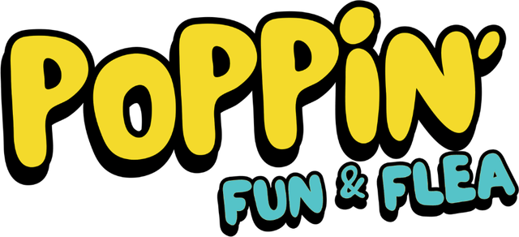
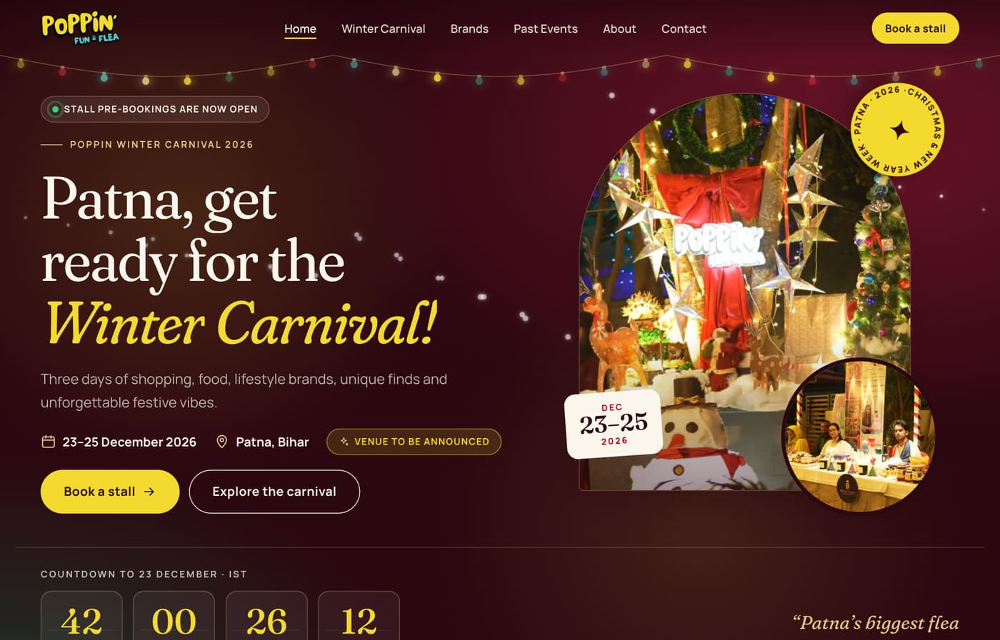
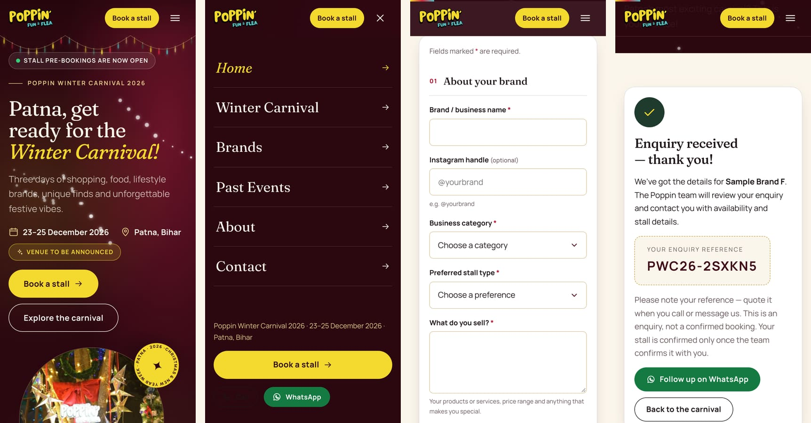
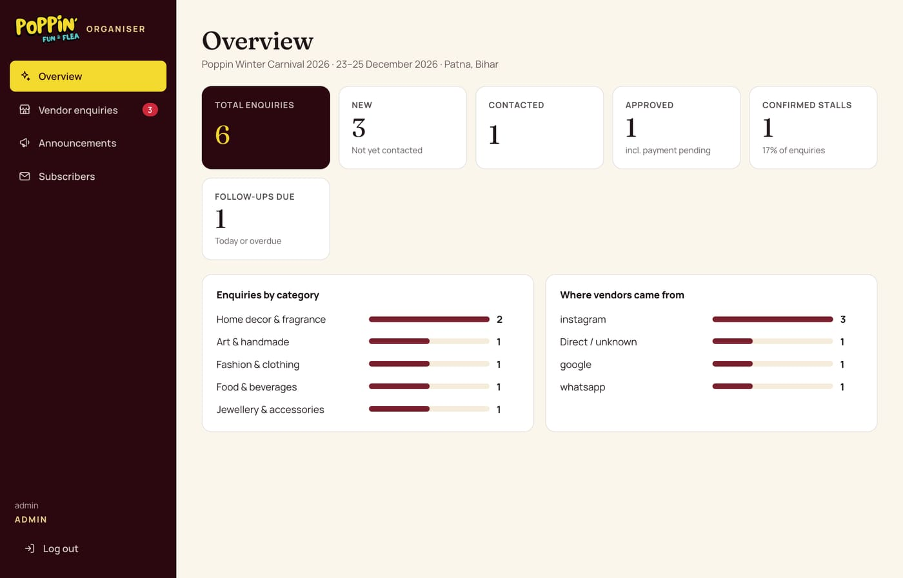
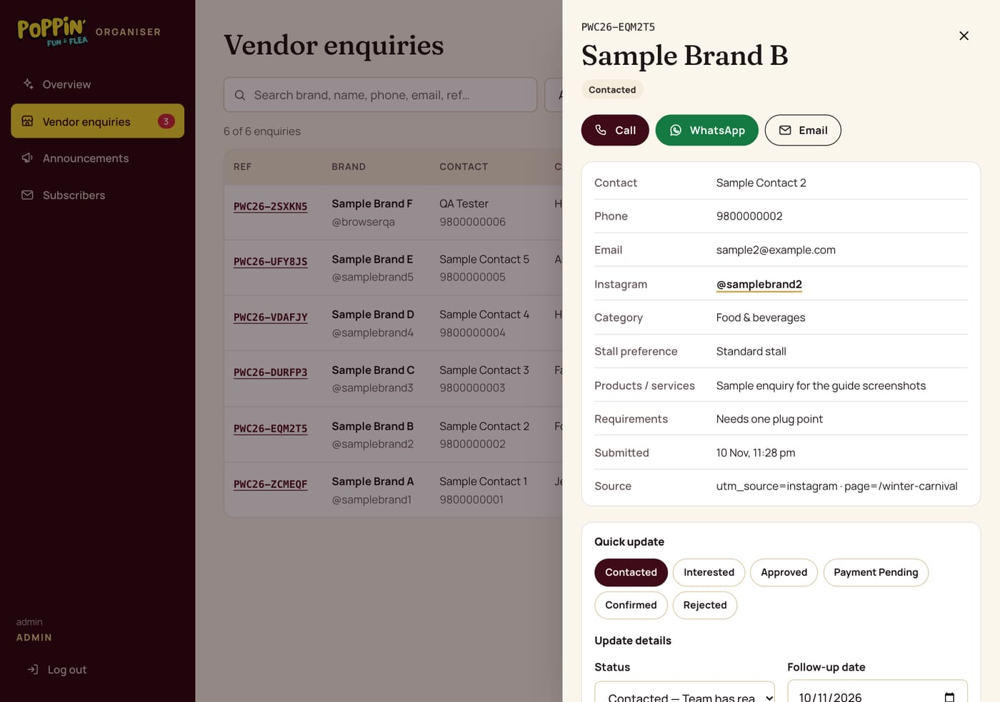
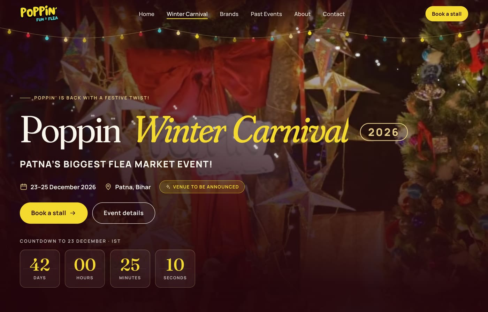
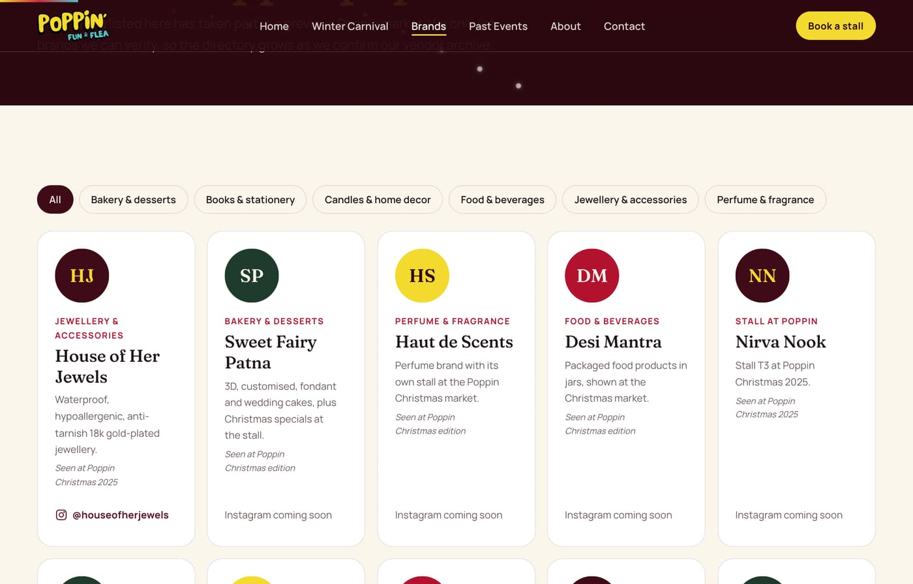
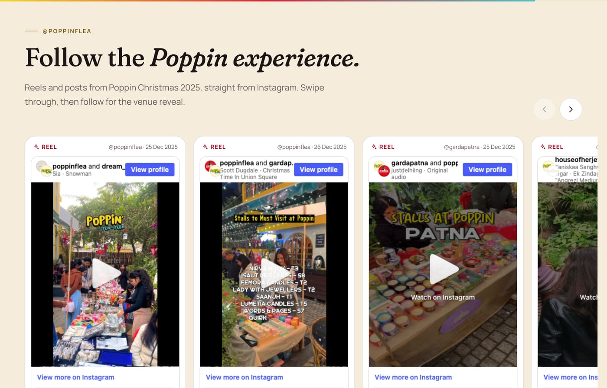
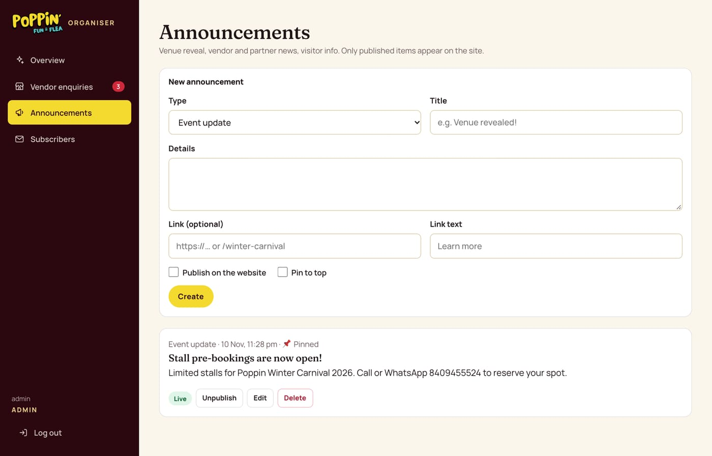

<div align="center">



# Poppin — Patna's Flea Market & Festive Events Platform

**The official website and organiser dashboard for Poppin' Fun & Flea, built for Poppin Winter Carnival 2026 (23–25 December, Patna).**

🌐 **Live:** [www.poppinflea.in](https://www.poppinflea.in) · 📸 [@poppinflea](https://www.instagram.com/poppinflea/)

   

</div>

<p align="center"></p>

## About the project

Poppin is a community-driven flea market and lifestyle event brand from Patna, Bihar, presented with its official partner **Garda Patna**. The website does three jobs:

1. **Promote the event.** Poppin Winter Carnival 2026 is front and centre, with a live countdown, event details and shareable pages.
2. **Collect stall bookings.** Businesses send a stall enquiry in under two minutes and get an instant reference number.
3. **Run the vendor pipeline.** Organisers manage every enquiry from a private dashboard backed by Google Sheets.

## ✨ Features

### For visitors
- 🎄 **Festive, editorial design**: Poppin's original logo with a winter palette of burgundy, festive red, cream, forest green and gold
- ⏳ **Live countdown** to 23 December in Indian Standard Time; switches to "happening now" during the event and to a thank-you message after it
- 📍 **Single source of truth for event facts**: dates, "Patna, Bihar" and "Venue to be announced" are set once and updated everywhere
- 🏷️ **Verified brand directory** with category filters: only brands seen at Poppin stalls or in Poppin's own reels
- 🤝 **Past partners**, kept separate from brands: Garda Patna, Satvika Celebration, Dream Maker, venue partners and sponsors
- 🗓️ **Event archive** of every previous edition: Christmas, Valentine's, Holi and Navratri
- 📸 **Instagram reels and posts** played on the site through Instagram's official embeds, loaded only when scrolled into view
- 🖼️ **Photo and video gallery** with a keyboard-friendly full-screen viewer
- 💬 **One-tap Call and WhatsApp** everywhere, with a ready-made stall enquiry message
- 📰 **Announcements** (venue reveal, partners, updates) published from the dashboard
- 📧 **Email update sign-ups** with consent and one-click unsubscribe
- 📱 **Built for phones first**: tested from 320px wide, sticky booking bar, no sideways scrolling, large tap targets

### Stall booking

<p align="center"></p>

- Validated form: brand, contact, phone, email, Instagram, category, products, stall type, requirements, consent
- Instant reference number (e.g. `PWC26-2SXKN5`), confetti and a confirmation email
- Organiser email alert with every detail
- Saved to Google Sheets and shown in the dashboard straight away
- Protected against double submissions, spam bots and repeated requests
- Clear messaging that an enquiry is **not** a confirmed booking until the team confirms it

### Organiser dashboard (`/admin`)

<p align="center"> </p>

- **Overview:** total, new, contacted, approved and confirmed enquiries, follow-ups due, and charts of categories and where vendors came from
- **Vendor CRM:** search, filter by status or category, full details, one-tap Call / WhatsApp / Email
- **Pipeline:** New → Contacted → Interested → Approved → Payment Pending → Confirmed (or Rejected / Cancelled), with one-tap status buttons
- **Notes and follow-ups:** private notes, follow-up dates and an activity log of who changed what
- **CSV export** of all enquiries
- **Announcements editor:** create, publish, pin, edit and delete site announcements
- **Subscribers:** list and export email sign-ups
- Not linked anywhere on the public site; every admin action is checked on the server

### Motion and interaction
String lights · gentle snowfall · word-by-word headline reveal · mouse-follow parallax · slow-zoom hero photo · tilting cards with glare · count-up stats · ticking countdown · scroll progress bar · partner marquee · button shine · confetti on success. Everything switches off automatically for visitors who prefer reduced motion.

### Search, sharing and accessibility
- Unique titles and descriptions, canonical URLs, sitemap and robots.txt
- Event, Organization and FAQ structured data, including the correct dates and venue-TBA information
- Branded 1200×630 preview image for WhatsApp, Instagram and other link previews
- Semantic HTML, skip link, labelled forms, keyboard support, WCAG AA colour contrast
- Optional cookieless analytics (Plausible): CTA clicks, contact clicks, enquiry starts and submissions

### Security
- Server-side admin login: scrypt-hashed password, signed HttpOnly session cookie, 8-hour sessions
- Every admin API requires a valid session; anonymous requests get `401`
- Login rate limiting, cross-site request checks, input validation and HTML escaping
- Spreadsheet and CSV formula-injection protection
- Security headers; admin and API routes kept out of search engines
- No secrets in the code; everything comes from environment variables

## 🖼️ More screens

| Winter Carnival page | Brands |
|---|---|
|  |  |
| **Instagram reels** | **Announcements editor** |
|  |  |

<sub>Dashboard screenshots use sample test data.</sub>

## 🧱 Tech stack

| Layer | Choice |
|---|---|
| Framework | Next.js 16 (Pages Router), React 19 |
| Styling | CSS Modules + design tokens, `next/font` (Fraunces & Manrope) |
| Data | Google Sheets API (one spreadsheet, a tab per collection) |
| Email | Nodemailer via Gmail |
| Media | `next/image` optimisation; Cloudinary for payment proofs (table bookings) |
| Motion | Plain CSS + small React hooks, no animation library |
| Hosting | Vercel |

## 🗂️ Project structure

```
components/
  admin/      dashboard: enquiries CRM, announcements, subscribers, table bookings
  forms/      stall enquiry form, newsletter sign-up
  layout/     navbar, footer, SEO, page header
  sections/   homepage & event sections
  ui/         countdown, gallery, Instagram carousel, motion helpers, icons
lib/
  config/     site contacts, Winter Carnival facts, CRM statuses, table-booking settings
  data/       brands, partners, past events, gallery, FAQ, Instagram posts  ← edit content here
  server/     auth, storage (Google Sheets / local), validation, email, rate limiting
pages/        routes and API endpoints (pages/api)
public/       images, logo, social preview image
scripts/      password hasher, env checker, API smoke test
```

## 🚀 Getting started

```bash
npm install
npm run dev        # http://localhost:3000
```

Create `.env.development.local` (it's gitignored) so local testing never touches live data:

```bash
DATA_DRIVER=local          # store data in .data/*.json instead of Google Sheets
EMAIL_DRIVER=log           # print emails in the terminal instead of sending them
ADMIN_EMAIL=admin          # admin username
ADMIN_PASSWORD_HASH=...    # npm run hash-password -- "your-password"
SESSION_SECRET=...         # printed by the same command
```

Useful scripts:

| Command | What it does |
|---|---|
| `npm run dev` | Local development server |
| `npm run build:local` / `npm run start:local` | Production build and server using local data only |
| `npm run hash-password -- "<password>"` | Generates an admin password hash and a session secret |
| `npm run check-env` | Shows which environment variables are set (never their values) |
| `npm run test:api -- <password>` | 50+ API checks against localhost (security, enquiries, CRM) |

See [`.env.example`](.env.example) for every variable.

## ☁️ Deployment

Deployed on **Vercel** from `main`. Required environment variables:

| Variable | Purpose |
|---|---|
| `GOOGLE_SHEETS_CLIENT_EMAIL`, `GOOGLE_SHEETS_PRIVATE_KEY`, `GOOGLE_SHEET_ID` | Google service account and spreadsheet |
| `EMAIL_USER`, `EMAIL_PASS` (Gmail App Password), `ORGANISER_EMAIL` (optional) | Confirmation emails and organiser alerts |
| `ADMIN_EMAIL`, `ADMIN_PASSWORD_HASH`, `SESSION_SECRET` | Dashboard login |
| `NEXT_PUBLIC_TABLE_BOOKING_ENABLED` (optional) | `true` re-opens customer table bookings |
| `NEXT_PUBLIC_PLAUSIBLE_DOMAIN` (optional) | Cookieless analytics |

The spreadsheet tabs `Vendor Enquiries`, `Announcements` and `Subscribers` are created automatically on first use. `Sheet1` holds customer table bookings.

## ✏️ Updating content

| What | Where |
|---|---|
| Venue, timings, stall prices (once confirmed) | `lib/config/event.js` |
| Contact number and WhatsApp messages | `lib/config/site.js` |
| Brands, partners, past events | `lib/data/brands.js`, `partners.js`, `events.js` |
| Gallery photos and videos | `lib/data/gallery.js` + `public/gallery/` |
| Instagram posts on the site | `lib/data/instagram.js` (paste the post link) |
| Site announcements | Dashboard → Announcements (no code needed) |

## 🛣️ Roadmap
- [x] Winter Carnival 2026 site, stall booking and vendor CRM
- [x] Announcements, subscribers, Instagram embeds, animations
- [ ] Venue reveal, timings and stall pricing (waiting on confirmation)
- [ ] Customer table bookings (built; switched off for now)
- [ ] Online stall payments after approval
- [ ] Emailing subscribers directly from the dashboard

## 📄 Project docs
[Project audit](PROJECT_AUDIT.md) · [Brand research](BRAND_RESEARCH.md) · [Revamp plan](REVAMP_PLAN.md) · [Feature roadmap](FEATURE_ROADMAP.md) · [Development log](DEVELOPMENT_LOG.md) · [Testing report](TESTING_REPORT.md)

---

<div align="center">Made for Poppin' Fun &amp; Flea · Patna, Bihar</div>
